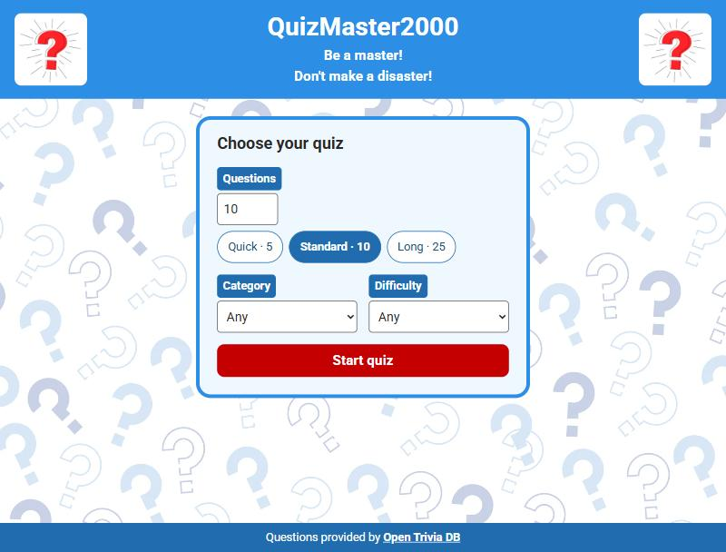
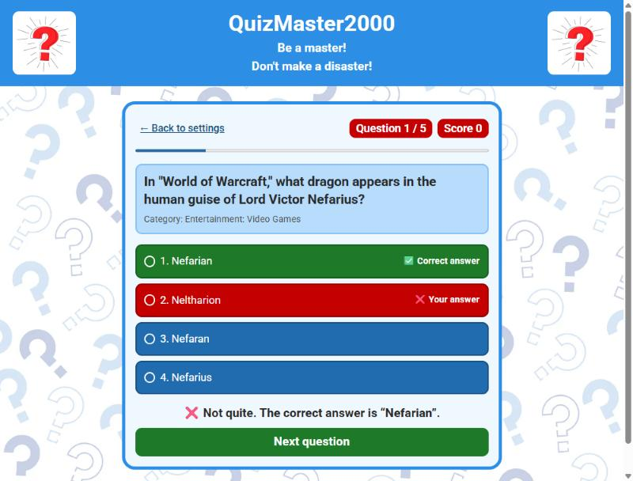
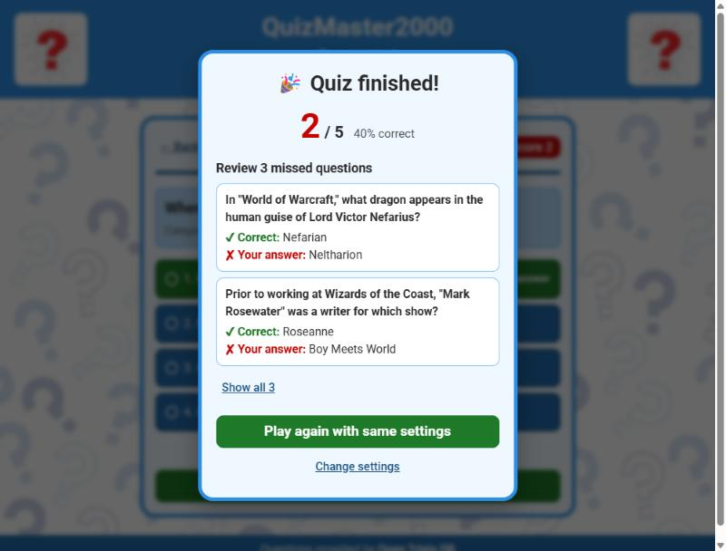

# TriviaQuiz


Interactive trivia quiz built with Vue 3, TypeScript and Vite.

## Screenshot







## Features

- Dynamic trivia questions from the Open Trivia DB API (multiple choice and true/false)
- Settings card with quick picks (Quick 5 / Standard 10 / Long 25), custom amount, category and difficulty, inline validation, and your last settings remembered in the browser
- Instant, non-colour-only feedback after each answer (icon + text + colour)
- Progress bar, score tracking and a result dialog that reviews every missed question, with "Play again with same settings" and "Change settings"
- Replayed quizzes avoid repeated questions (Open Trivia DB session token, with a safe fallback if it is unavailable)
- Loading, error and empty states for every request (including a retry for categories)
- Fully keyboard-operable: `1`–`4` pick an answer, `Enter` checks / continues
- Accessible by design: labelled form controls, radio-group answers, live-region feedback, visible focus, WCAG AA contrast, `prefers-reduced-motion` support
- Responsive layout for mobile and desktop

## Getting started

Requires Node.js 20+.

```bash
git clone https://github.com/TranceMeli/TriviaQuiz.git
cd TriviaQuiz
npm install
npm run dev
```

| Script              | Purpose                          |
| ------------------- | -------------------------------- |
| `npm run dev`       | Start the dev server             |
| `npm run build`     | Type-check and build to `dist/`  |
| `npm run preview`   | Serve the production build       |
| `npm run typecheck` | Type-check only (`vue-tsc`)      |
| `npm test`          | Run the unit tests (Vitest)      |

## Project structure

```
index.html                    Vite entry
src/
  main.ts                     App bootstrap
  App.vue                     Page layout, switches between setup and quiz
  types.ts, constants.ts      Shared types and limits
  api.ts                      Open Trivia DB client (fetch, session token, error mapping, decoding)
  composables/useQuiz.ts      All quiz state and rules (framework-light, unit-tested)
  components/
    AppHeader.vue             Title banner
    QuizSetup.vue             Settings form (number, category, difficulty)
    QuizQuestion.vue          Question, answer options, feedback
    ResultModal.vue           Final score dialog (native <dialog>)
  styles/main.css             Design tokens and shared button styles
  utils/shuffle.ts            Fisher–Yates shuffle
  utils/storage.ts            Validated load/save of the last settings (localStorage)
```

## Credits

Questions provided by [Open Trivia DB](https://opentdb.com/).

Assets provided by [Magnific](https://www.magnific.com/).
